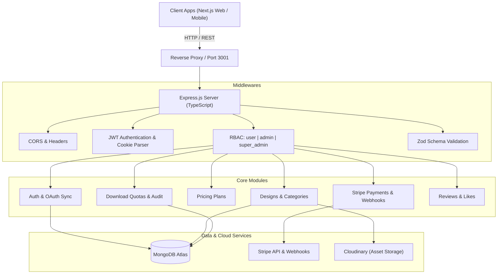

# 🚀 LZ Fly — Backend REST API

[](https://nodejs.org/)
[](https://www.typescriptlang.org/)
[](https://expressjs.com/)
[](https://www.mongodb.com/)
[](https://stripe.com/)
[](LICENSE)

An enterprise-ready, modular RESTful API engine powering the **LZ Fly** digital asset marketplace and SaaS subscription platform. Built with **Express**, **TypeScript**, **MongoDB**, **Zod**, and **Stripe**, offering end-to-end security, role-based access control, automated webhook lifecycle processing, and high-performance digital downloads.

---

## 📋 Table of Contents

- [System Architecture](#-system-architecture)
- [Key Features](#-key-features)
- [Tech Stack](#-tech-stack)
- [Project Directory Structure](#-project-directory-structure)
- [Environment Configuration](#-environment-configuration)
- [Quick Start Guide](#-quick-start-guide)
- [Authentication & Role Hierarchy](#-authentication--role-hierarchy)
- [Complete REST API Specification](#-complete-rest-api-specification)
  - [Health & System](#health--system)
  - [Authentication & OAuth](#authentication--oauth)
  - [Users Management](#users-management)
  - [Design Assets](#design-assets)
  - [Categories](#categories)
  - [Pricing & Subscription Plans](#pricing--subscription-plans)
  - [Purchases & Subscriptions](#purchases--subscriptions)
  - [Stripe Payments & Webhooks](#stripe-payments--webhooks)
  - [Secure Downloads & Quotas](#secure-downloads--quotas)
  - [Reviews & Ratings](#reviews--ratings)
  - [Likes & Bookmarks](#likes--bookmarks)
- [Validation & Error Handling](#-validation--error-handling)
- [Security Features](#-security-features)
- [Scripts Reference](#-scripts-reference)

---

## 🏛 System Architecture



---

## ✨ Key Features

- **Robust Modular Architecture**: Built following Clean Architecture patterns with decoupled `controllers`, `services`, `models`, `routes`, and `validations`.
- **Tri-Tier Role-Based Access Control**: Strict access boundaries (`user`, `admin`, `super_admin`) where `super_admin` has administrative override and management privileges.
- **Hybrid Authentication**: Dual authentication support for credentials-based JWT tokens and OAuth synchronization (Google & GitHub) with automatic session persistence.
- **Full Stripe Payment Engine**: Server-side PaymentIntent creation, webhook verification using raw payload parsing, and resilient payment status confirmation.
- **Digital Asset Download Quotas**: Dynamic download rights management verifying active subscription validity, remaining quotas, and individual purchase ownership.
- **Strict Zod Runtime Validation**: Request query parameters, route parameters, and request bodies are validated with typed Zod schemas before reaching business logic.
- **Auditing & Metrics**: Historical logging of downloads, purchases, reviews, and transaction status changes.

---

## 🛠 Tech Stack

| Component | Technology | Description |
| :--- | :--- | :--- |
| **Runtime** | Node.js (v18+ LTS) | High-performance asynchronous JavaScript engine |
| **Language** | TypeScript 5.x | Strict compile-time typing and maintainability |
| **Framework** | Express.js 4.x | Fast, unopinionated minimalist web framework |
| **Database** | MongoDB 6+ | Flexible NoSQL document database |
| **ODM** | Mongoose 8.x | Strongly typed object modeling and validation |
| **Payments** | Stripe SDK (Node) | Secure online payments, PaymentIntents & Webhooks |
| **Validation** | Zod | TypeScript-first schema declaration and validation |
| **Auth** | JSON Web Tokens & bcrypt | Secure password hashing & stateless bearer tokens |
| **File Storage** | Cloudinary | Cloud digital media management and CDN delivery |
| **Logging** | Morgan | HTTP request logger middleware |

---

## 📂 Project Directory Structure

```text
lz-fly-backend/
├── src/
│   ├── app.ts                          # Express application setup & middleware registration
│   ├── server.ts                       # Server bootstrap & MongoDB connection handler
│   └── app/
│       ├── config/
│       │   └── index.ts                # Centralized environment variable configurations
│       ├── errors/                     # Custom error handlers & global exception classes
│       ├── middlewares/
│       │   ├── auth.ts                 # JWT authentication & role authorization middleware
│       │   ├── validateRequest.ts      # Generic request validation wrapper
│       │   └── validateZodSchemas.ts   # Body/Query/Param Zod validation middleware
│       ├── modules/
│       │   ├── auth/                   # Authentication, registration, OAuth sync
│       │   ├── category/               # Design categories management
│       │   ├── design/                 # Design asset catalog and metadata
│       │   ├── download/               # File download authorization, quota & logs
│       │   ├── like/                   # Design like and favorites system
│       │   ├── payments/               # Stripe payment intents, webhooks & status
│       │   ├── pricingPlan/            # Subscription plans & access tier management
│       │   ├── purchase/               # Purchases, orders & active subscription tracking
│       │   ├── review/                 # User ratings, reviews & review moderation
│       │   └── user/                   # User profile, role assignment & admin controls
│       └── routes/
│           └── index.ts                # Central API router mounting all module routes
├── dist/                               # Compiled production JavaScript files
├── .env.example                        # Template for environment variables
├── package.json                        # Dependencies, scripts, and package metadata
├── tsconfig.json                       # TypeScript compiler options
└── nodemon.json                        # Hot-reload configuration for development
```

---

## ⚙️ Environment Configuration

Create a `.env` file in the root of `lz-fly-backend/` based on `.env.example`:

```env
# Application Environment
NODE_ENV=development
PORT=3001

# Database Configuration
MONGODB_URI=mongodb+srv://<username>:<password>@cluster0.mongodb.net/lz-fly?retryWrites=true&w=majority

# JWT Authentication
JWT_ACCESS_SECRET=your_super_secret_jwt_access_key_min_32_chars
JWT_ACCESS_EXPIRES_IN=7d
JWT_REFRESH_SECRET=your_super_secret_jwt_refresh_key_min_32_chars
JWT_REFRESH_EXPIRES_IN=30d

# Stripe Payment Gateway
STRIPE_SECRET_KEY=sk_test_51...
STRIPE_WEBHOOK_SECRET=whsec_...

# Client URLs (CORS)
CLIENT_URL=http://localhost:3000
FRONTEND_URL=http://localhost:3000

# Cloudinary Storage (Optional for file uploads)
CLOUDINARY_CLOUD_NAME=your_cloud_name
CLOUDINARY_API_KEY=your_api_key
CLOUDINARY_API_SECRET=your_api_secret
```

---

## 🚀 Quick Start Guide

### 1. Prerequisites
- **Node.js**: v18.0.0 or higher
- **npm** or **yarn**
- **MongoDB**: Local instance running on `27017` or MongoDB Atlas URI

### 2. Installation
```bash
cd lz-fly-backend
npm install
```

### 3. Running in Development Mode
```bash
npm run dev
```
The server will start with hot-reloading at **`http://localhost:3001`**.

### 4. Production Build & Execution
```bash
npm run build
npm start
```

---

## 🔐 Authentication & Role Hierarchy

The platform implements a strict multi-tier authorization hierarchy:

```text
super_admin ────────► Full administrative power + Role management + Direct deletion overrides
     │
     ▼
   admin     ────────► Product, category, review, payment & plan management
     │
     ▼
   user      ────────► Browse, like, review, purchase, and download authorized files
```

- **Authentication Methods**:
  - `Bearer <JWT_TOKEN>` provided in the `Authorization` request header.
  - Or via HTTP-Only `token` cookie.
- **OAuth Synchronization**:
  - Whenever a user logs in via NextAuth on the frontend (Google/GitHub), the user details are synchronized via `/api/auth/oauth-sync`, generating a valid backend JWT.

---

## 📡 Complete REST API Specification

### Base URL: `/api`

### Health & System
| Method | Endpoint | Access | Description |
| :--- | :--- | :--- | :--- |
| `GET` | `/health` | Public | System health check and API ping |

---

### Authentication & OAuth
| Method | Endpoint | Access | Description |
| :--- | :--- | :--- | :--- |
| `POST` | `/auth/register` | Public | Register new user account |
| `POST` | `/auth/login` | Public | Login with email & password |
| `POST` | `/auth/logout` | Authenticated | Logout user & clear cookies |
| `POST` | `/auth/refresh-token` | Public | Issue new access token from refresh token |
| `POST` | `/auth/oauth-sync` | Public | Synchronize NextAuth OAuth user with database |
| `GET` | `/auth/me` | Authenticated | Retrieve current user profile and role |

---

### Users Management
| Method | Endpoint | Access | Description |
| :--- | :--- | :--- | :--- |
| `GET` | `/users` | Admin, Super Admin | Paginated user list with role & status filters |
| `GET` | `/users/:id` | Admin, Super Admin | Fetch user details by ID |
| `PATCH` | `/users/:id` | Admin, Super Admin | Update user information, role, or status |
| `DELETE` | `/users/:id` | Super Admin | Permanently remove user account |
| `GET` | `/users/profile/me` | Authenticated | Get currently authenticated profile |
| `PATCH` | `/users/profile/update` | Authenticated | Update authenticated user details |

---

### Design Assets
| Method | Endpoint | Access | Description |
| :--- | :--- | :--- | :--- |
| `GET` | `/designs` | Public | Browse designs with search, category & sorting |
| `GET` | `/designs/:id` | Public | Single design asset details |
| `GET` | `/designs/featured/list` | Public | Fetch featured designs for home banner |
| `POST` | `/designs` | Admin, Super Admin | Create new design product |
| `PUT` | `/designs/:id` | Admin, Super Admin | Full update of existing design |
| `PATCH` | `/designs/:id` | Admin, Super Admin | Partial update of design fields |
| `DELETE` | `/designs/:id` | Admin, Super Admin | Soft-delete / remove design asset |

---

### Categories
| Method | Endpoint | Access | Description |
| :--- | :--- | :--- | :--- |
| `GET` | `/categories` | Public | Get all active categories |
| `GET` | `/categories/:id` | Public | Get single category by ID |
| `POST` | `/categories` | Admin, Super Admin | Create a new category |
| `PATCH` | `/categories/:id` | Admin, Super Admin | Update category title, slug, or icon |
| `DELETE` | `/categories/:id` | Admin, Super Admin | Delete a category |

---

### Pricing & Subscription Plans
| Method | Endpoint | Access | Description |
| :--- | :--- | :--- | :--- |
| `GET` | `/pricing-plans/active` | Public | Get active plans for pricing page |
| `GET` | `/pricing-plans` | Admin, Super Admin | List all plans with analytics & pagination |
| `GET` | `/pricing-plans/:id` | Public | Get plan details by ID |
| `POST` | `/pricing-plans` | Admin, Super Admin | Create new pricing tier |
| `PATCH` | `/pricing-plans/:id` | Admin, Super Admin | Update pricing, features, or download limits |
| `DELETE` | `/pricing-plans/:id` | Admin, Super Admin | Archive or delete a plan |

---

### Purchases & Subscriptions
| Method | Endpoint | Access | Description |
| :--- | :--- | :--- | :--- |
| `GET` | `/purchases/my-purchases` | Authenticated | List all purchases made by user |
| `GET` | `/purchases/subscription-status`| Authenticated | Active subscription validity & remaining quota |
| `GET` | `/purchases/admin/all` | Admin, Super Admin | Audit trail of all platform purchases |
| `GET` | `/purchases/:id` | Authenticated | View purchase receipt by ID |

---

### Stripe Payments & Webhooks
| Method | Endpoint | Access | Description |
| :--- | :--- | :--- | :--- |
| `POST` | `/payments/create-payment-intent` | Authenticated | Create Stripe PaymentIntent for plan or asset |
| `POST` | `/payments/webhook` | Public (Stripe Signature)| Handle Stripe event callbacks (raw body) |
| `GET` | `/payments/status/:id` | Authenticated | Real-time payment verification polling |
| `GET` | `/payments/admin/all` | Admin, Super Admin | Administrative transactions overview |
| `POST` | `/payments/refund/:id` | Super Admin | Process refund for a completed transaction |

---

### Secure Downloads & Quotas
| Method | Endpoint | Access | Description |
| :--- | :--- | :--- | :--- |
| `POST` | `/downloads/request/:designId` | Authenticated | Validate rights & return signed download link |
| `GET` | `/downloads/history` | Authenticated | User download history & re-download links |
| `GET` | `/downloads/admin/all` | Admin, Super Admin | System-wide download audit log |
| `GET` | `/downloads/analytics/overview`| Admin, Super Admin | Download frequency and quota statistics |

---

### Reviews & Ratings
| Method | Endpoint | Access | Description |
| :--- | :--- | :--- | :--- |
| `GET` | `/reviews/design/:designId`| Public | Public reviews and rating breakdown for asset |
| `POST` | `/reviews` | Authenticated (Buyer)| Submit star rating and written review |
| `PATCH` | `/reviews/:id` | Authenticated (Author) | Update user review |
| `DELETE` | `/reviews/:id` | Authenticated / Admin | Delete review |
| `GET` | `/reviews/admin/all` | Admin, Super Admin | Moderation queue of all platform reviews |

---

### Likes & Bookmarks
| Method | Endpoint | Access | Description |
| :--- | :--- | :--- | :--- |
| `POST` | `/likes/design/:designId` | Authenticated | Toggle like/favorite state on design |
| `GET` | `/likes/design/:designId` | Authenticated | Check if user liked a design |
| `GET` | `/likes/my-likes` | Authenticated | Retrieve user saved favorite designs |

---

## 🛡 Validation & Error Handling

All incoming payloads are strictly validated against **Zod schemas**. When validation fails or an exception occurs, the API returns a structured, predictable error payload:

```json
{
  "success": false,
  "message": "Validation Error",
  "errorMessages": [
    {
      "path": "price",
      "message": "Price must be a positive number"
    }
  ],
  "stack": "..." // Only present in development mode
}
```

---

## 🔒 Security Best Practices

- **Strict CORS Protection**: Whitelists only trusted domains and automated Vercel preview URLs.
- **Raw Webhook Parsing**: Stripe webhook endpoints bypass standard JSON body parsing to guarantee signature integrity against replay attacks.
- **Password Salting**: Passwords hashed using `bcrypt` with work factor 10.
- **Rate-Limiting & Sanitization**: Prevents brute-force access and parameter pollution.

---

## 📜 Available Scripts

| Command | Action |
| :--- | :--- |
| `npm run dev` | Starts server with `ts-node-dev` hot reload |
| `npm run build` | Compiles TypeScript source to production `/dist` directory |
| `npm start` | Executes compiled production server (`dist/server.js`) |
| `npm run lint` | Runs ESLint check across all TypeScript source files |
| `npm test` | Executes backend test suite |

---

<p align="center">
  <b>LZ Fly</b> • Advanced Digital Asset Marketplace Backend<br>
  Engineered with high standards for speed, security, and scalability.
</p>
